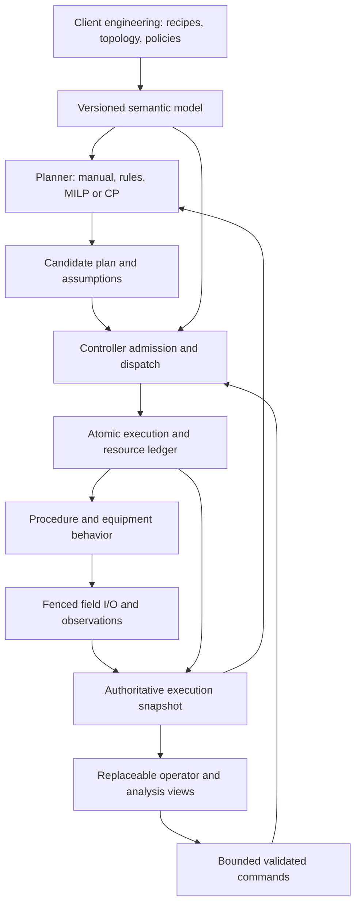

# Chemical production scheduling and reusable batch foundations

**Research and design proposal, 20 October 2026 · [Issue #1531](https://github.com/Jan-Kaspar1/dcs/issues/1531)**

Preserved in the repository at Kaspar's request alongside the [platform requirements](../requirements/platform.md). Recommendations remain proposals; the batch market is deferred.

## Recommendation and decision status

Reconsider batch support around the distinction between **process intent, predicted plans, admitted work, and observed physical outcomes**. Build a shared semantic model and explicit execution contracts before choosing library blocks or an optimization algorithm. A schedule proposes future work; a deterministic controller authorizes and executes a bounded portion against current conditions and declared continuation constraints. An optional optimizer operates outside the control scan. A simple, explicit dispatch policy remains a valid planning implementation where it satisfies the application.

This is a proposed direction for review, not an accepted architecture decision. No batch engine, new market stage, deployment, runtime change, or implementation backlog is authorized by this note. Existing architecture is reviewed below as a migration constraint, not treated as evidence that its decomposition is correct. The batch requirements remain deferred; the requirement IDs here are research candidates only.

The recommendation is conditional: begin with one process cell under one authoritative execution domain. Plants needing distributed ownership across multiple controller pairs require a separate protocol and failure model. Neither the book nor ISA-88 settles the DCS deployment architecture.

## Scope, evidence, and access limits

The question is what reusable foundations allow independently owned client plants to express chemical production intent, share constrained equipment, execute procedures, and recover intelligibly, while allowing different scheduling methods. No target customer, process narrative, plant size, economic objective, or validated process timing has been supplied. Chemical and pharmaceutical requirements must be established separately.

Both originating attachments are the same distributed-computing/HA report. Their SHA-256 is `8cd51b5ea7c0d6d57c4deb3efa66799badfa6b800a09ca9224fbfa65cbe19185`; their first heading is “Distributed Computing und Hochverfügbarkeit industrieller Steuerungen”. Their originating attachment identifiers are:

- `dc54ab5d-5ded-4e4c-8f8f-f4dd0490debd/Pasted text.txt`
- `b4af869a-7aab-49a3-97ec-c79719067174/Pasted text.txt`

No separate scheduling report was supplied. The HA report is not used as scheduling evidence. If the intended report arrives, reconcile its claims against this source ledger and revise the proposal rather than appending an assumed endorsement.

The named book is Christos T. Maravelias, *Chemical Production Scheduling: Mixed-Integer Programming Models and Methods*, Cambridge University Press, 2021, DOI [10.1017/9781316650998](https://doi.org/10.1017/9781316650998). The publisher's contents and public frontmatter were accessible; the full book was not. The accessible contents identify chapters on single-unit through network environments, storage and transfer extensions, and real-time scheduling. The relevant reading locators are chapter 1; chapters 3–7; chapter 8, especially §§8.1–8.3; chapters 12–13; and chapter 14, especially §§14.2–14.4. These are reading locators, not claims that those chapters were read in full. [Publisher frontmatter, printed pp. ix–xvi](https://assets.cambridge.org/97811071/54759/frontmatter/9781107154759_frontmatter.pdf).

ISA's current catalogue lists Part 1 (2010), Part 2 (2001), Part 3 (2003), Part 4 (2006), and a 2022 machine/unit-state implementation report. The accessible ANSI Part 1 preview contains the contents, introduction, and scope; it does not expose the detailed normative clauses. The Part 2 preview is only a scope page. Full normative verification remains open; this proposal makes no ISA-88 conformance claim. [ISA catalogue](https://www.isa.org/standards-and-publications/isa-standards/find-isa-standards-by-topic), [ANSI Part 1 preview](https://webstore.ansi.org/preview-pages/ISA/preview_ANSI%2BISA%2B88.00.01-2010.pdf), [ISA Part 2 preview](https://www.isa.org/getmedia/9b598b1c-029b-4116-a6cb-4e1ec285df3b/S_880002_preview.pdf).

Repository context was read through connected GitHub because the configured local checkout is absent. The inspected baseline is commit [`f53400ed39ccb2e0cced76a3bdbe3935e0360f68`](https://github.com/Jan-Kaspar1/dcs/commit/f53400ed39ccb2e0cced76a3bdbe3935e0360f68). The governing context is [AGENTS.md](https://github.com/Jan-Kaspar1/dcs/blob/f53400ed39ccb2e0cced76a3bdbe3935e0360f68/AGENTS.md), [product strategy](https://github.com/Jan-Kaspar1/dcs/blob/f53400ed39ccb2e0cced76a3bdbe3935e0360f68/docs/product-strategy.md), [batch requirements](https://github.com/Jan-Kaspar1/dcs/blob/f53400ed39ccb2e0cced76a3bdbe3935e0360f68/docs/requirements/batch-control.md), and architecture/plan documents. Water and wastewater remains the active implementation market. This evidence does not pass a later market's gate.

## Findings supported by research

The following are bounded source findings. The design that follows is original DCS synthesis and should be challenged against plant evidence.

| Evidence | Finding | Consequence to investigate |
| --- | --- | --- |
| Sundaramoorthy and Maravelias, 2011, *A General Framework for Process Scheduling*, pp. 695–697, abstract and background; [author paper hosted by CMU](https://cepac.cheme.cmu.edu/pasi2011/library/maravelias/Sundaramoorthy.2011.AIChE.GeneralScheduling.pdf), [DOI](https://doi.org/10.1002/aic.12300). Full paper accessible; classification/background inspected. | Sequential representations preserve batch identity through stages; network representations allow material mixing/splitting. A facility may contain both. State-task networks represent material states/tasks; resource-task networks generalize resource treatment to equipment, materials, and utilities. A common discrete grid helps couple balances and resource use, while continuous-time formulations introduce different computational difficulties. | Classify material relationships per process segment. Neither a simple recipe tree nor anonymous inventory alone can represent every plant. |
| Maravelias group, *Modeling*, undated, checked 2026-10-20; [research page](https://maravelias.princeton.edu/research/chemical-production-scheduling/modeling), opening paragraphs and references. | The group's models address different production environments and features including utility availability/prices, sequence-dependent changeovers, and batching decisions. | Equipment compatibility, changeover history, and shared resources belong in explicit problem data. |
| Maravelias group, *Theory & Solution Methods*, undated, checked 2026-10-20; [research page](https://maravelias.princeton.edu/research/chemical-production-scheduling/theory-solution-methods), theory and solution-methods sections. | Methods include tightening, multiple/nonuniform time grids, and discrete–continuous refinement. Computational results depend on formulation and problem structure. | Do not commit the public plant API to one time grid or promise that one solver handles arbitrary plant scale. |
| Gupta and Maravelias, 2017, *A General State-Space Formulation for Online Scheduling*, [author preprint, §§2–4, particularly §3.8](https://www.preprints.org/manuscript/201710.0125/v1/download); final article [DOI](https://doi.org/10.3390/pr5040069). Preprint accessible; final publisher page failed to open. | The formulation explicitly represents disturbances, in-progress tasks, and post-production storage in a processing unit. A hold task retains material in its producing unit under a no-intermediate-storage policy. | The scheduling snapshot needs occupied units and in-flight work, not merely a queue of unstarted batches. Finishing a transformation does not necessarily free equipment. |
| Gupta and Maravelias, 2016, *On Deterministic Online Scheduling: Major Considerations, Paradoxes and Remedies*, [institutional abstract](https://collaborate.princeton.edu/en/publications/on-deterministic-online-scheduling-major-considerations-paradoxes/); article pp. 312–330, [DOI](https://doi.org/10.1016/j.compchemeng.2016.08.006). Abstract-level access used. | Open-loop optimization and closed-loop implemented scheduling are different problems even without uncertainty. | Evaluate realized performance under repeated planning, not only a single solver objective value. |
| Rawlings et al., 2019, *Incorporating Automation Logic in Online Chemical Production Scheduling*, [publisher abstract, introduction and section previews](https://www.sciencedirect.com/science/article/pii/S0098135419300699), §§2–5, pp. 201–215; [DOI](https://doi.org/10.1016/j.compchemeng.2019.06.015). Detailed full paper not accessed. | Coarse scheduling models can produce infeasible execution plans. The authors combine periodic scheduling with formal analysis of automation logic to predict delays and trigger replanning; their case study reports better closed-loop performance. | Keep an explicit model-to-execution feasibility boundary. Formal checks can improve that boundary but are not automatically required for every plant. |
| McAllister, Rawlings and Maravelias, 2022, *The Inherent Robustness of Closed-Loop Scheduling*, [publisher abstract, introduction and conclusion snippets](https://www.sciencedirect.com/science/article/pii/S0098135422000229); [DOI](https://doi.org/10.1016/j.compchemeng.2022.107678). NSF full-text endpoint failed to open. | Robustness results depend on assumptions, a nominal reference trajectory, and suitable terminal constraints/costs. The paper addresses large, infrequent disturbances; naive repeated optimization can perform poorly. | Replanning alone is no robustness guarantee. Record horizon-end assumptions, feasible continuation, and disturbance scope. |
| ANSI/ISA-88.00.01-2010, [preview](https://webstore.ansi.org/preview-pages/ISA/preview_ANSI%2BISA%2B88.00.01-2010.pdf), contents pp. 3–6, introduction p. 13, scope p. 17. | The standard provides reference models and terminology. Its contents separately address process/equipment models (§4), procedural and coordination control (§5), recipes and equipment links (§6), modes/states and exceptions (§7), planning/scheduling and control activities (§8). | Use the distinctions as a review framework. They do not dictate one software object or network service for every model element. |
| OPC Foundation, *OPC 10030: Common Object Model—ISA-95*, [§8.2 and equipment-model overview](https://reference.opcfoundation.org/specs/OPC-10030/full). | Role-based equipment identity is distinct from a replaceable physical asset. Equipment classes, properties, and capability tests serve different information needs. | Keep stable logical equipment/capability identifiers separate from field-device bindings. This source is an information-model reference, not an ownership protocol. |
| Google OR-Tools, [job-shop documentation](https://developers.google.com/optimization/scheduling/job_shop), constraints and interval-model example, checked 2026-10-20. | The example expresses precedence and machine non-overlap with interval variables and CP-SAT. | Constraint programming is a viable comparison for fixed-job sequencing. Chemical material balances and identity rules would require additional modeling. No performance comparison was run here. |

The group’s [online-scheduling page](https://maravelias.princeton.edu/research/chemical-production-scheduling/online-scheduling) provides a useful research overview: only current decisions from successive plans are implemented, while feedback changes future plans. Its reference list has inconsistent year/volume pairings for two papers; use the individual publisher/DOI records rather than copying that bibliography.

## Requirements before decomposition

The following candidate requirements express what a representative batch application would need to demonstrate. They are hypotheses for review, not customer-validated product scope. Each needs a named owner and numeric limits before acceptance.

| Candidate ID | Required observable behavior | Evidence or assumption; example acceptance scenario |
| --- | --- | --- |
| CPS-C01 — identity and provenance | Distinguish recipe definition/revision, instantiated control recipe, batch, lot/sublot, operation invocation, plan revision, and equipment identity. Pin the executed definition. | ISA recipe/equipment separation; proposed identity scheme. Editing the next recipe revision leaves an in-flight instance unchanged and traceable. |
| CPS-C02 — material semantics | Preserve declared split/mix restrictions, quantity units, lot genealogy, location, quality/release state, and measured/estimated provenance. | Sequential/network research. Two lots of one material cannot silently pool across a forbidden merge; quarantined material is not usable feed. |
| CPS-C03 — capability matching | Match process requirements against equipment limits, topology, condition and current availability; expose the failed predicate. | Scheduling and equipment-model evidence. A vessel with adequate volume but wrong material compatibility or no transfer path is rejected. |
| CPS-C04 — complete constraints | Account for occupancy, transfer, storage, utility/manpower limits, cleaning/changeover and required timing relationships. | Scheduling research. The two-reactor counterexample below is rejected before irreversible production begins. |
| CPS-C05 — bounded authority | Execute only admitted requests through bounded controller-owned transitions. Planner, UI and telemetry timing cannot pace the control scan. | DCS product intent; proposed planner boundary. Killing the optimizer leaves already-admitted work following its declared execution policy. |
| CPS-C06 — atomic resource decisions | Prevent incompatible concurrent uses, distinguish future reservations from actual ownership, and require a proven release condition. | Proposed correctness invariant. Opposite-order acquisition requests cannot partly acquire and deadlock; a lost request signal does not prove a full vessel free. |
| CPS-C07 — procedural behavior | Define ordering, legal concurrency, start/completion conditions, mode/state transitions and process-specific abnormal behavior. | ISA review framework. A hold request during reaction has an explicit phase response and acknowledgement, rather than assuming all outputs freeze. |
| CPS-C08 — command/effect distinction | Correlate admission, application, operation progress, physical confirmation, and final outcome; deduplicate retries within a declared scope. | Proposed distributed-command contract. Lost acknowledgement after a dose causes reconciliation, not automatic redosing. |
| CPS-C09 — recovery | Restore a mutually consistent procedure/resource/material baseline and reconcile it with fresh field observations before new consequential actions. | State-space scheduling plus proposed recovery semantics. Restart during transfer exposes retained claims and uncertain quantity until reconciled. |
| CPS-C10 — replanning | Include in-progress work, retain immutable committed decisions, reject stale assumptions, and distinguish timeout/no solution from proven infeasibility. | Online-scheduling evidence. A plan generated before a breakdown cannot start work on that unit. |
| CPS-C11 — visible operation | Show intent, state, equipment assignment, ownership, blockers, measurement quality, intervention needs and command outcomes from a shared contract. | Existing unified-interface intent. An operator can explain why a ready batch waits without reconstructing Boolean wiring. |
| CPS-C12 — independent client composition | An external plant repository can compose the application using pinned supported releases, declare site policy, and validate it without private platform imports. | DCS client-boundary requirement. A second, differently arranged cell consumes the same contracts without changing platform internals. |
| CPS-C13 — evidence and timing bounds | Declare scan/memory/queue bounds, planning deadlines, clock semantics, data freshness, and record retention/recovery obligations. | Proposed measurable nonfunctional contract. Queue saturation produces a named refusal; event loss is visible; a planner misses its deadline without extending a scan. |

These candidates do not imply electronic-signature, pharmaceutical validation, or complete manufacturing-execution-system requirements. Those depend on separately established customer scope.

## Theoretical model and semantic boundaries

### Different models answer different questions

Use a connected set of projections over shared identities and versioned declarations, not one representation forced onto every purpose:

| Representation | Question it answers | Distinction that matters |
| --- | --- | --- |
| Process/material model | What transformations, quantities and routing are permitted? | Material state in a state-task network is not the procedural state “held” or “running”. |
| Recipe/procedure definition | What approved steps and parameters produce this product? | A recipe graph is not automatically a complete material/resource scheduling model. |
| Capability/equipment model | Which equipment can perform the requested work, under which limits and conditions? | Capability is a declared ability; availability and permission are time-varying facts. |
| Scheduling projection | When, where and at what quantity should future work occur under stated assumptions? | A planned reservation is not a present actuation grant. |
| Execution state | What work has been admitted, what is progressing, and what outcomes are confirmed? | Accepted command, completed operation and physically achieved result differ. |
| Physical I/O model | Which devices and signals realize and observe the operation? | Logical ownership does not itself fence competing field writers. |

ISA-88's recipe/procedure/equipment distinctions are useful conceptual anchors. For DCS review, use the familiar recipe procedure → unit procedure → operation → phase vocabulary, while validating exact definitions and permitted collapsing/expansion against the full standard before adoption. A phase should expose bounded, meaningful equipment behavior such as “transfer a measured quantity,” including abnormal behavior. A valve block need not become a recipe phase, and a scheduler task may aggregate several phases. The mapping must be declared and versioned rather than inferred from matching names.

Likewise, a batch can create multiple lots, and an operation can consume several lots. A schedule “task” is a modeling decision; do not assume every batch, recipe node, equipment module and optimizer variable maps one-to-one.

### Minimum scheduling mathematics

The following is an original illustrative constraint sketch, not a transcription of a book formulation or a complete solver specification. Assume a finite horizon, known candidate operations, fixed task durations for the example, compatible quantity units, and discrete start times. For operation `o`, eligible unit `u`, and time `t`, let `x[o,u,t]` be a binary start choice, and `b[o,u,t]` its batch quantity.

```text
For each required operation o:
    sum(u,t) x[o,u,t] = 1

For each eligible start choice:
    Bmin[o,u] * x[o,u,t] <= b[o,u,t] <= Bmax[o,u] * x[o,u,t]

For each modeled material m and event time t:
    I[m,t] = I[m,t-1]
             + confirmed/planned production arriving at t
             - consumption departing at t
             + declared external receipts/shipments/adjustments
    0 <= I[m,t] <= storage_capacity[m,t]

For each renewable resource r and time t:
    sum(active operations o) demand[o,r,t] <= available_capacity[r,t]

For predecessor o and successor q:
    start[q] >= finish[o] + minimum_lag[o,q]
    start[q] <= finish[o] + maximum_lag[o,q]   (where required)
```

Only eligible assignments are allowed; optional operations need explicit selection logic rather than the equality above. The resource constraint must cover the actual required interval: setup, transfer, processing, occupied waiting, cleanup and verified release where applicable. Sequence-dependent cleaning needs adjacency/history constraints or explicit condition transitions. Lot-preserving processes need identity/routing constraints in addition to aggregate material balances. Transfer needs a feasible path, source material, destination capacity and coordinated use of both endpoints. Shared storage needs segregation and compatibility constraints, not just a scalar total capacity.

For simple fixed-duration tasks a time-indexed model can express active occupancy with starts over the relevant duration window. Variable duration, partial consumption/production, nonlinear kinetics, blending quality, uncertain yields, and condition-dependent cleaning require additional models or validated approximations. Never silently translate those features into constant durations or perfect yields.

Separate hard constraints from objectives. Product integrity, physical capacity and required process timing cannot become cheap penalty violations. Candidate objectives include due-date performance, waste, energy and changeover cost, and plan stability. Select priorities and units with the plant owner; an arbitrary weighted sum can trade away the objective the operator actually cares about. A feasible solver incumbent with a reported gap differs from a proven optimum. A timeout with no incumbent differs from a proof of infeasibility.

### A counterexample that changes the design

This is an invented, hand-checked review fixture, not plant evidence. Two 100 kg batches use separate reactors R1/R2; each reaction takes 30 minutes. Both discharge through one transfer route P into one filter F. Transfer takes 5 minutes, filtration takes 20, and F is exclusive from transfer start through filtration end. There is no intermediate buffer. Transfer must begin within 10 minutes after reaction completion. Reactors remain occupied until discharge is confirmed. Initial equipment is qualified and materials available. For illustration, reactor cleaning takes 10 minutes using one CIP skid, only after confirmed discharge. Filter turnaround is included in its stated duration.

A plan with both reactions at 0–30 looks attractive if it models only reactors. A can transfer at 30–35 and filter at 35–55; B cannot transfer until 55. B waits 25 minutes, violating its 10-minute limit. Merely rejecting B's transfer at minute 30 is too late: B already contains time-sensitive product.

A feasible illustrative sequence is:

| Activity | A | B |
| --- | --- | --- |
| Reaction | R1, 0–30 | R2, 25–55 |
| Transfer; source stays occupied through end | P and F, 30–35 | P and F, 55–60 |
| Filtration | F, 35–55 | F, 60–80 |
| Reactor cleaning on shared CIP skid | R1 and CIP, 35–45 | R2 and CIP, 60–70 |

Intervals are half-open. F occupancy is `[30,55)` and `[55,80)`; route and CIP intervals do not overlap. Both transfers start immediately after reaction completion. This establishes feasibility under the stated deterministic assumptions, not optimality or disturbance robustness.

Design implication: admission before an irreversible step must check an approved continuation to the next safe waiting point, including downstream capacity commitments and a response to loss of that capacity. A check of currently idle equipment alone is insufficient. If F fails after A's reaction starts, no scheduler can guarantee the invented timing limit without additional physical alternatives; a plant-approved containment/disposition policy is required. A runtime gate cannot manufacture feasibility.

## Compare viable approaches

### Architecture alternatives

| Approach | Strengths | Main cost/failure mode | Fit |
| --- | --- | --- | --- |
| One scan-based block owns recipe, scheduling, resources and output patterns | Small deployment; direct local state | Economic search and control timing interfere; difficult reuse and testing; one enum often conceals independent facts | Suitable only for a deliberately small fixed procedure; poor generic platform foundation |
| Deterministic execution/coordination with replaceable off-scan planning | Explicit authority; supports manual plans, heuristics and optimization; bounded scan work | Requires a rigorous mapping and stale-plan/continuation checks | Recommended baseline hypothesis |
| Equipment agents negotiate work through distributed choreography | Local autonomy and organizational separation | Multi-resource atomicity, deadlock, partial failures, fencing and recovery become distributed protocol problems | Revisit for a named multi-domain plant; no present evidence justifies this cost |
| Fully integrated scheduling and dynamic process control | Can account jointly for sequence and process dynamics | Larger mathematical and validation burden; solve deadline and model mismatch remain material | Specialized future option where measured coupling benefits justify it |

These are logical boundaries, not a demand for separate processes or microservices. The execution state, resource ledger and admission decision should initially share one authoritative transaction boundary. Planning can be an independent process, or isolated background work with a strict resource budget; it never holds scan state locked while solving.

### Scheduling method alternatives

| Method | Appropriate starting case | Tradeoff to measure |
| --- | --- | --- |
| Manual order / FIFO / explicit priority dispatch with lookahead constraints | Few alternatives, ample capacity, stable procedures | Easy explanation and bounded decisions; can starve work or make poor downstream choices without explicit fairness/continuation rules |
| Discrete-time MILP with state-task/resource-task ideas | Material-coupled networks, shared utility calendars, batching choices | Clear balances and time-dependent capacities; grid resolution changes model size and timing fidelity |
| Continuous-time or precedence/event-based MILP | Sparse events or sequencing with important exact timing | Avoids a uniform fine grid; cross-unit synchronization, inventories and changeovers require careful formulations; smaller does not imply faster |
| Constraint programming / CP-SAT with interval constraints | Fixed batches, precedence and equipment assignment dominate | Natural interval reasoning; additional treatment needed for chemical quantities, inventory and split/mix semantics; numeric scaling matters |
| Decomposition or discrete–continuous hybrid | Demonstrated bottleneck on representative larger cases | Can exploit structure; adds approximation/mapping and maintenance obligations |
| Integrated dynamic optimization | Proven economically important dependence of duration/quality on control trajectories | High fidelity for an identified application; substantial model and computation cost |

The comparison is a design judgment informed by the source findings, not a benchmark result. Recommend **a common planning contract, an explainable dispatch reference, and a discrete-time MILP comparison for the first material-coupled research fixture**. Do not select a production solver, grid or performance target until a real plant instance exists. A fixed-batch sequential plant may favor CP or precedence formulations instead. STN/RTN ideas organize planning data; their uniform mathematical treatment of resources must not erase runtime distinctions between conserved material, exclusive equipment, and renewable utility capacity.

## Proposed execution and client contracts

### Responsibilities and authority



**Planning** chooses predicted allocations, quantities and timing over a horizon. It reads a coherent scheduling snapshot, including running work, claims, material condition and measured uncertainty. Its result carries model/recipe/capability revisions, observation baseline, plan revision, time basis, validity conditions, objective/solver status and future reservations. It cannot write field outputs or declare physical completion.

**Dispatch** selects the next eligible work from the approved plan/policy. It revalidates affected assumptions at the controller boundary, obtains the needed resource bundle, and starts an execution instance. It may reject or defer with a structured reason. Reordering or substituting equipment is allowed only within a declared policy envelope; otherwise it requires a new plan or operator decision. A displayed future reservation may remain tentative. A continuation commitment required before an irreversible start must have explicit enforceability, capacity and failure semantics.

**Procedure execution** tracks approved parameter values, graph position, enabled transitions, child operation invocations and physical result evidence. It determines progress from specified conditions, not from the optimizer's predicted finish. Parallel branches, join semantics, iterations and exceptions must be explicit and bounded for scan-time analysis. Full graph generality should not be promised before a representative recipe demands it.

**Equipment behavior** implements operations against logical I/O, including permissives, feedback, completion, abnormal transitions and release evidence. A capability declaration contains parameter/result units and bounds, eligible conditions and required resources. “Transfer” includes destination/path compatibility; “heat” includes valid operating limits and a declared response to unavailable heating/cooling. Scheduling duration is a prediction; completion criteria are an execution contract.

**Resource coordination** is authoritative for current claims, compatibility and release. **Field write ownership** remains an independent enforcement boundary: a logical claim is insufficient if another controller can write the same actuator. **Independent protection** remains outside the optimizer's authority; the optimizer cannot waive a protection condition to preserve a schedule.

### Start from semantic records, not a fixed block catalogue

The reusable core should express at least these concepts. Their packaging is an open implementation decision:

- Versioned recipe/procedure definition and pinned execution instance.
- Capability requirement, equipment offer, eligible binding and declared scheduling/execution mapping.
- Material lot/location/quantity/release facts with provenance and identity-preservation rules.
- Operation invocation with durable correlation identity, parameters, lifecycle and effect evidence.
- Resource bundle, tentative reservation, enforceable commitment, current claim and proven release.
- Coherent execution/scheduling snapshot and candidate plan with dependency revisions.
- Named command/refusal/outcome and event records with explicit retention and recovery duties.

A later library can offer tested equipment operations, bounded procedure composition, resource-bundle coordination, model-to-planner adapters and operator presentations. Reuse should be measured by the second distinct plant using these contracts. A universal `BatchBlock`, one arbitrary state machine per phase, or a generic lock block is not justified yet. Basic control blocks remain useful components beneath this boundary.

### Resource lifetime and progress

For every incompatible resource use, require one authoritative current claimant. Distinguish `reserved`, `claimed`, `in use`, `releasing`, `released`, and `uncertain` as logical lifecycle facts; exact public vocabulary remains to be reviewed. Ownership and operational availability are independent: a claimed reactor may be unavailable for a new task while still actively containing material.

Acquire the necessary bundle atomically within the authority domain, or refuse/defer the entire start. Include source, destination, route and utilities at the appropriate granularity. Do not acquire every resource for the entire batch by default; that wastes capacity. Do not release future-critical resources before there is a viable continuation. Choose the acquisition scope around the next process-approved waiting point. Waiting cannot be assumed safe for every product.

Use a deterministic conflict policy, explicit queue/fairness rules and bounded queues. All-or-nothing acquisition prevents partial lock accumulation inside the domain; it does not by itself prevent process deadlock, starvation or a no-buffer material cycle. Static topology checks plus lookahead/scenario analysis must cover those cases. Cross-domain bundles need a separately reviewed distributed protocol.

Loss of a Boolean request, client session, timer lease or telemetry quality must not independently prove equipment empty or a transfer completed. Reclaiming software authority requires fencing; reclaiming occupied process capacity requires observed/reconciled process facts. Timeout can trigger an abnormal procedure, but it cannot create a release fact.

### State, modes, commands and recovery

Do not collapse these axes into one giant enum:

| Axis | Example facts |
| --- | --- |
| Procedure progress | Not started, executing, waiting, completed, terminated |
| Requested operating mode | Automatic procedure, operator-directed operation, maintenance policy |
| Abnormal behavior | Holding requested, holding in progress, held, aborting, reconciliation needed |
| Equipment/material condition | Clean/dirty, qualified/unqualified, occupied/empty, released/quarantined |
| Authority | Claimant identity, resource grant, field fencing generation |
| Confidence/effect | Fresh observation, estimated quantity, effect confirmed, outcome uncertain |

These are illustrative DCS facts, not a copied ISA or PackML state model. Each legal combination and transition needs a contract. A parent hold request must aggregate child acknowledgements and preserve necessary local control. Holding a reaction may require continued cooling/agitation. Abort may require a controlled drain or containment, retain occupied equipment, and await disposition. Neither means “set all outputs false.” Resetting software state cannot erase material or cleaning requirements.

Commands carry a stable request and invocation identity, expected instance/revision/state where relevant, actor and policy context. A receipt answers whether a request was admitted/applied/rejected according to the declared command contract. Separate operation events establish started/progress/completed/failed/uncertain outcomes. A retry with the same identity must not initiate a second dose. The deduplication retention horizon and behavior after its expiry must be explicit.

A checkpoint/recovery baseline must relate the pinned recipe instance, invocation IDs, graph/phase state, remaining timing obligations, committed decisions, resource ownership, material locations/quantities/confidence and command/effect records. Restoring only the current step is insufficient. Compatible hot takeover and a cold restart after unobserved field movement are different recovery cases.

For a lost reply during transfer: retain the claim, query trusted progress/quantity/valve feedback, and reconcile whether the transfer completed, partially completed or remains uncertain. Retry only an operation with an explicitly idempotent or resumable equipment contract. Ordinary message deduplication cannot guarantee exactly-once physical effects. If evidence is inadequate, expose an intervention state with permitted containment actions and a recorded disposition.

A durable intent before a consequential action is one possible recovery requirement, but it creates a timing tradeoff. Do not synchronously block every scan on storage. Where that durability is required, admission can await a separately persisted intent while existing control continues, or use another validated persistence mechanism. Define what happens when storage is unavailable. An asynchronous event journal with visible gaps is not automatically a complete batch recovery log.

Use distinct clock domains: deterministic controller elapsed time, engineering duration units, planning calendar timestamps/timezone, and observed external-device time. Record conversions and uncertainty. Run ticks from different epochs cannot be compared directly. A pause of procedure progression does not necessarily pause a product's maximum residence time or an actual cooling duty. Clock jumps, restart downtime and unknown observation intervals need declared policies.

### Replanning and planner failure

Replan periodically and/or on meaningful changes; tune the policy through closed-loop simulation. A candidate plan identifies the data it depends on. Admission checks those dependencies and current constraints, rather than rejecting every plan simply because unrelated telemetry advanced. Overlapping plan submissions use an expected committed revision so late results cannot overwrite newer commitments.

Already executed actions cannot be revised. Treat started work and the necessary near-term commitments as fixed or explicitly renegotiable with acknowledgement. Add plan-stability and horizon-end treatment where evidence warrants them; reoptimizing more often is not inherently better. A solver's feasible status covers its mathematical model, not all unmodeled automation conditions.

If the optimizer disappears, existing equipment control and admitted procedures follow their declared policies. New work may use a preapproved simple dispatcher only if its continuation checks remain valid; otherwise it waits. Do not automatically fall back to FIFO for a tightly coupled plant. Solver failure, stale state, invalid model, proven infeasibility and timeout without an incumbent need different operator explanations. Execution remains deterministic for identical admitted decisions and observations even if repeated solver runs choose different equally good plans.

### The reusable client boundary

Client-owned Rust engineering code should describe recipes, parameters, topology, capability bindings, timing/material restrictions, exception policy and presentation context using versioned supported APIs. It compiles these into validated, bounded declarations that a generic runtime can execute. It does not embed a solver or arbitrary customer Rust callbacks in the control scan.

This is a proposed extension of the current release model, not a capability already proved by `dcs-build`. A declaration-only runtime cannot execute arbitrary new plant behavior. Novel equipment behavior therefore needs either an approved platform library addition or a separately designed, versioned extension mechanism with timing, state and recovery contracts. The latter remains open; do not require private imports or a platform fork as an accidental customer interface.

Engineering validation should check referenced identities, unit/dimension compatibility, capability bindings, topology, legal graph joins, split/mix rules, resource scope and declared exception/recovery completeness. Runtime checks still handle material observations and time-varying conditions. Compile-time types cannot prove a vessel is empty, clean or available.

Operator views should derive measurements, configuration, runtime facts, commands and events from the same semantic declarations. Show the recipe revision, current operation, assigned equipment, owners, blockers and pending operator action. Command availability in a displayed snapshot is advisory until revalidated at admission. Economic optimizer internals need only appear where they explain a meaningful decision, such as a delayed batch or infeasible continuation.

## Existing DCS: retain, adapt, or reject as a generalization

This review occurred after the requirements and conceptual alternatives were established. It is a limited source inspection at the pinned revision, not a full implementation or safety audit. No tests were executed, and no runtime defect is asserted solely because a water-specific component lacks chemical-batch semantics.

| Existing evidence | Recommendation | Reason and remaining proof |
| --- | --- | --- |
| [Typed composition and spec declarations](https://github.com/Jan-Kaspar1/dcs/blob/f53400ed39ccb2e0cced76a3bdbe3935e0360f68/crates/dcs-build/src/spec.rs#L1), architecture decisions 31 and 79–81 | Retain the independently versioned client boundary; extend only after contract review | Public composition is useful; port/parameter declarations alone do not express recipes, lots, topology-dependent capabilities or continuation constraints. |
| [BlockInterface](https://github.com/Jan-Kaspar1/dcs/blob/f53400ed39ccb2e0cced76a3bdbe3935e0360f68/crates/dcs-core/src/interface.rs#L1), [served resource views](https://github.com/Jan-Kaspar1/dcs/blob/f53400ed39ccb2e0cced76a3bdbe3935e0360f68/crates/dcs-core/src/resources.rs#L1), decisions 82–84 | Retain schema-driven observation, named commands/events and bounded consumer separation; adapt semantic records | Current state is adapted from status-role ports; configuration is parameter-oriented. That is not proof of a complete batch-instance or material model. Here “resources” means served UI resources, not an equipment-allocation ledger. |
| [Sequencer](https://github.com/Jan-Kaspar1/dcs/blob/f53400ed39ccb2e0cced76a3bdbe3935e0360f68/crates/dcs-blocks/src/sequencer.rs#L25), state capture at [line 639](https://github.com/Jan-Kaspar1/dcs/blob/f53400ed39ccb2e0cced76a3bdbe3935e0360f68/crates/dcs-blocks/src/sequencer.rs#L639) | Retain as a timed-sequence utility; reject its promotion into a general batch engine | It drives the active step's output even while `run` is false, holds position on bad input, advances by scan count, and offers `advance`/`reset`. Its documented contract is narrower than phase completion, material disposition, qualified ownership and recovery. “Hold” cannot be inherited as a universal chemical-process response. |
| [Backwash coordinator](https://github.com/Jan-Kaspar1/dcs/blob/f53400ed39ccb2e0cced76a3bdbe3935e0360f68/crates/dcs-blocks/src/backwash_coordinator.rs#L180) | Retain the water-specific component and its arbitration examples; replace the inferred generic ownership design | It coordinates one supply grant, releases on request drop/non-Good request, and retains a holder while permissives gate the grant output. Those are explicit local semantics. They do not prove an occupied vessel safe to reassign or atomically coordinate multiple resources. |
| [Backwash sequence](https://github.com/Jan-Kaspar1/dcs/blob/f53400ed39ccb2e0cced76a3bdbe3935e0360f68/crates/dcs-blocks/src/backwash_sequence.rs#L1) | Retain measured completion, timeout and abnormal-policy examples in their declared domain; do not clone the parameter table into a universal recipe schema | It has domain-specific triggers, step codes and abort/fault policies. A new chemical procedure needs its own semantic specification and evidence, including product residence time and physical resource release. |
| [Checkpoint contract](https://github.com/Jan-Kaspar1/dcs/blob/f53400ed39ccb2e0cced76a3bdbe3935e0360f68/crates/dcs-runtime/src/checkpoint.rs#L1), architecture decisions 35 and 84 | Retain deterministic replay/checkpoint and compatibility principles; requalify batch recovery as a separate obligation | The existing checkpoint carries component and command state. That does not establish atomic persistence of future batch/material/resource records, reconciliation after unobserved field action, or exactly-once physical dosing. |

Discard these assumptions from the fresh design: recipe tree equals schedule; step done equals equipment free; a Boolean request/grant represents all ownership facts; `run=false` is a safe phase hold; retry after missing acknowledgement is harmless; a feasible MILP solution is executable; and one reusable block hierarchy must mirror ISA's conceptual models. These are rejected design assumptions, not findings that every current component makes them.

## Review scenarios and evidence plan

The next authorized design step can be a paper/simulation evidence pack; implementation remains separately gated. Before a production design is accepted, nominate at least one real process narrative and a second contrasting client composition. Use the same semantic fixture to compare manual/rule dispatch and candidate optimization models.

| Scenario | Required observation | Main candidates |
| --- | --- | --- |
| Two-reactor, no-buffer example | Reject simultaneous reactions before the irreversible start; accept the hand-checked plan under its assumptions | C03, C04, C06 |
| Forbidden lot merge; quarantine after planning | Genealogy remains explicit; no unapproved mixing or quarantined consumption | C01, C02, C10 |
| Opposite-order requests for reactor/route/destination | One complete bundle or a named defer; no partial claims; no deadlock from lock order | C06 |
| Destination fails after reaction begins | Follow declared containment/disposition policy; show the missed timing risk without claiming a feasible schedule exists | C04, C07, C11 |
| Cleaning or utility condition changes | Current qualified capability and planned capacity disagree visibly; new starts revalidate | C03, C04, C10 |
| Duplicate request / lost response after dose | One logical invocation; physical outcome reconciled; no unqualified automatic repeat | C08, C09 |
| Hold, abort and reset at different phases | Meaningful phase-specific responses; retained material/resource facts; no fabricated empty/clean state | C06, C07, C09 |
| UI/optimizer failure and saturated ingress | Existing scans/control continue within the declared bound; commands refused by name; no undeclared scheduling fallback | C05, C13 |
| Hot takeover, cold restart, unknown field interval | Consistent restored execution/claim baseline; uncertainty exposed until field reconciliation; no stale authority writing | C08, C09 |
| Late plan and overlapping replans | Newer commitments preserved; stale affected assumptions refused; started work not rewritten | C10 |
| Short horizon and repeated replanning | Compare realized production, lateness, waste and churn against the reference dispatcher; expose horizon-end stranded work | C04, C10 |
| Independent external plant build | Same pinned release contracts express a changed topology and recipe without private imports or platform edits | C12 |

Measure realized constraint violations, throughput/late deliveries, material loss, plan churn, wait/starvation, solver latency and feasible-incumbent rate, scan timing under load, recovery time, duplicate physical effects and retained-evidence gaps. Values remain **TBD with owner evidence**, not invented acceptance numbers. Use deterministic disturbances first, then empirically justified distributions and fault cases. A perfect undisturbed Gantt chart is insufficient evidence.

Formal modeling is a targeted option: bounded state exploration of resource/procedure transitions can test exclusivity, legal transitions, wait cycles and duplicate-admission invariants. Such a model covers its abstraction and assumptions; it does not verify unmodeled chemistry or prove a complete plant safe. Solver feasibility checking, runtime admission and process protection each address different obligations.

## Assumptions, open questions, and recommendation gate

| Open question | Current working assumption | Evidence needed to settle it |
| --- | --- | --- |
| Which plant and production problem comes first? | One chemical process cell; no pharmaceutical baseline inferred | Owner/integrator process narrative, products, equipment topology, operating modes and acceptance cases |
| May batches mix/split, and where must identity persist? | Explicit per segment; no silent pooling | Material/genealogy policy and quality requirements |
| What is a safe waiting point? | Process-specific; reaction cannot simply pause | Maximum residence times, minimum/maximum lags, containment and disposition narrative |
| Which limits dominate scheduling? | Equipment, transfer/storage, cleaning and utilities are candidates | Measured durations/yields, utility limits, cleaning matrix and maintenance/operator calendars |
| Who selects/reassigns equipment? | Plan proposes; controller revalidates; substitutions constrained by declared policy | Operator roles, release/approval workflow, cost of reassignment |
| Can the cell be one authority domain? | Yes for the research baseline only | Deployment topology, cross-pair shared resources, expected partition behavior |
| What physical evidence proves completion and release? | Feedback/quantity evidence required; no timeout-only release | Instrumentation, observability, device command semantics and uncertainty bounds |
| How much durability is required before action? | Not yet established | Permitted recovery loss, persistent medium behavior, batch-record retention and power-loss scenarios |
| What happens without a planner? | Continue admitted behavior; new work waits unless a validated fallback exists | Operating narrative, acceptable autonomy window and fallback feasibility evidence |
| How much custom plant behavior must generic releases support? | Bounded declarations plus known equipment operations | Two independent plant compositions; unsupported behavior examples and extension/timing policy |
| What planning horizon/objective/solver budget is acceptable? | No numeric commitment | Demand cadence, economics, operator response expectations and measured representative benchmarks |
| Which full standard clauses apply? | ISA-88 is a conceptual reference only at present | Licensed Part 1 clauses 4–9, applicable Parts 2–4; review by a batch-domain expert |
| What did the missing scheduling report actually claim? | Unknown | The distinct report, if available, followed by claim-by-claim reconciliation |

Recommend accepting **the investigation direction**: shared identities and explicit semantic projections; controller-owned admission/execution/resource facts; replaceable off-scan planning; and a client-owned, versioned engineering interface. Defer the final state vocabulary, block catalogue, solver, grid, extension mechanism and distributed ownership protocol until the named evidence exists. This leaves room to retain useful DCS foundations while replacing assumptions that fail the no-buffer, recovery and multi-resource examples.

## Investigation verification and preservation

Source access was checked on 20 October 2026. Attachment equality was verified by SHA-256 and heading inspection. Repository observations refer to the pinned baseline above. The illustrative schedule was independently checked for resource overlap, precedence, durations and maximum wait under its deterministic assumptions; it is not plant evidence or an optimization benchmark.

This note preserves the original investigation. Adding it to the repository does not implement an execution engine or accept its architecture proposals. The original local checkout was unavailable, and no Rust/platform test result is claimed by this research. Current documentation-change checks and CI limitations belong to the associated review record.
